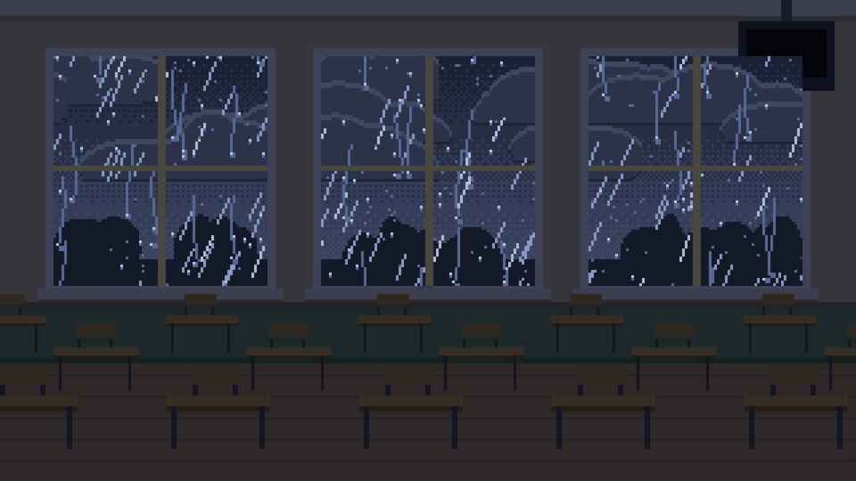

# 星溯 MV 工坊（xingsu-mv-studio）

一个以中文编写的 Agent Skill，把用户提供的歌曲、歌词和创意整理成动画 MV：支持水彩手绘、像素校园角色和 Clawd 角色，按节拍设计动作与转场，逐字对齐歌词，导出 2K 母版、720p 预览、SRT/VTT、分镜和标题关键帧。

作者：星溯鱼。建议仓库名：`mv-creation-skill`。

## 能做什么

- 从音乐结构和用户文本设计故事、角色、分镜与开场。
- 水彩 / 像素 320 / 像素 640 多套引擎；可选校园男女主、Clawd 等角色。
- 拍点检测、节拍网格、逐字时间与卡拉 OK；纯器乐也可按旋律安排画内文字。
- 横屏 2560×1440 或竖屏 2:3 1440×2160 母版；附 720p 预览、3:4 与 4:3 标题关键帧。
- 分段渲染、断点续做和局部返修；慢歌剧情与可复用道具细则随包收录。

这是一组供智能体读取的工作流程和代码资源，需要具备文件读写与命令执行能力的宿主工具。部分历史模块是移植参考，不能直接当成完整成片工程运行。

## 效果图

下列图片从作者桌面成片的无歌词片段截取，已人工确认没有歌词字幕和个人署名；仅收录静态截图，歌曲音频、视频不随仓库分发。




截图来源：《东西》0.2 秒、《我好想你》15 秒、《晴天》5.5 秒。歌名只作工程示例名称。

## 依赖与安装

需要 **Python 3.10+**、**ffmpeg / ffprobe**（可在终端直接调用，ffmpeg 需包含 libx264 与 AAC）。Python 依赖见根目录 `requirements.txt`；字体与模型按需下载。Node.js / npm 仅在使用 p5 模板时需要，Python 引擎与字体下载无需 Node。

在仓库根目录创建独立环境：

```bash
python3 -m venv .venv
source .venv/bin/activate
python3 -m pip install -r requirements.txt
ffmpeg -version
ffprobe -version
```

**Claude Code**：把整个 `skills/xingsu-mv-studio/` 复制到个人技能目录 `~/.claude/skills/xingsu-mv-studio/`，或项目的 `.claude/skills/xingsu-mv-studio/`。例如从仓库根目录执行：

```bash
mkdir -p ~/.claude/skills
cp -R skills/xingsu-mv-studio ~/.claude/skills/
```

在 Claude Code 中通过 `/xingsu-mv-studio` 调用，也可以直接描述制作动画 MV 的任务。安装目录以 [Claude Code 技能文档](https://code.claude.com/docs/en/skills) 为准。 如果已安装旧名 `mv-creation`，请移除或禁用旧版后再安装新版，避免重复加载。

**其他支持 SKILL.md 的工具**：将完整 `xingsu-mv-studio` 目录复制到宿主规定的技能目录，确认宿主可以读取其脚本和资源。设备传输工具不会在各宿主间自动通用。

## 首次使用

1. 编辑 `skills/xingsu-mv-studio/config.json` 的 `SIGNATURE`，把「★你的署名」换成自己的署名。未设置时技能应先询问用户；环境变量 `MV_SIGNATURE` 可覆盖配置。
2. 提供你有权使用的歌曲音频和歌词，指定歌曲区间、画幅与角色。仓库中的歌词都是等长占位示例，旧时序仅用于演示结构，不能用于其他歌曲的正式对齐。
3. 在独立工程目录复制所需引擎、技能的 `scripts/` 和 `config.json`，按 `SKILL.md` 和引擎 README 准备数据。原资源保持只读，输出写到用户指定目录，默认 `./MV作品/<歌名>_MV/`。
4. 先渲预览自查，再导出母版。实际音乐需要重新检测拍点和逐字对齐。

### 字体

在工程目录执行（`scripts/` 从技能目录复制）：

```bash
# 水彩：站酷快乐体随仓库分发；文楷用于署名等文字
python3 scripts/get_fonts.py fonts --wenkai
# 像素 320
python3 scripts/get_fonts.py fonts --unifont --fp12
# 像素 640
python3 scripts/get_fonts.py assets --unifont
```

下载器通过 Python 直接获取字体包，无需 npm。下载的文楷、Unifont、Fusion Pixel 不纳入 Git；再分发时请遵守各自许可。随包 `ZCOOLKuaiLe-Regular.ttf` 使用 SIL OFL 1.1。

### 人声分离、识别模型与笔顺

`scripts/align_lyrics.py` 首次使用时下载 UVR `UVR-MDX-NET-Voc_FT.onnx` 和 sherpa-onnx SenseVoice 模型（合计约 230 MB），默认缓存在 `~/.cache/mv-creation/models/`，不随仓库分发。需要可访问来源站点的网络，已有模型可按脚本帮助指定缓存位置。

`scripts/build_strokes.py` 根据用户提供的文字从 Make Me a Hanzi 提取所需汉字笔顺。例如：

```bash
python3 scripts/build_strokes.py data/lyrics.json --out code/strokes.json
```

随附两个 `strokes.json` 仅保留占位歌词的示例字符；换歌词或片名后须重新生成。修改与许可说明见对应目录的 `strokes-说明.md`。模型、字体与笔顺的来源详见 [组件来源](skills/xingsu-mv-studio/references/sources.md)。

## 目录

```text
README.md                    中文使用说明与效果图
LICENSE                      本项目代码和文档的 MIT 许可证
THIRD_PARTY_LICENSES.txt      上游 MIT、字体 OFL 与笔顺 APL 全文
requirements.txt             Python 依赖
.gitignore                   素材、下载模型、渲染输出等忽略规则
docs/                        无歌词的效果截图
skills/xingsu-mv-studio/
  SKILL.md                   技能入口
  config.json                可配置署名
  references/                制作、来源与交付说明
    notes/                   原编号 01–08 细则
  scripts/                   拍点、对齐、笔顺、字体、渲染和编码工具
  assets/
    engines/watercolor-clawd/ 水彩引擎及占位示例
    engines/pixel-320-couple/ 像素校园男女主 320 引擎
    engines/pixel-640/        像素 640 引擎
    engines/watercolor-modules/ 按来源工程整理的水彩模块
    engines/pixel-modules/   额外像素角色模块
    painted-character/      可选 p5 模板（保留上游 LICENSE）
```

工程模块来源与用途见 `skills/xingsu-mv-studio/assets/engines/watercolor-modules/README.md`。仅收录实际引用的代码及必要本地导入文件，原工程音频、歌词、渲染图片和 chunks 不随模块收录。原说明中的《说好不哭》48px 角色工程已删除，未补造。

## 本次整理验证与待处理项

2026-11-05 已在独立 Python 3.12 环境按 `requirements.txt` 完整安装依赖，`pip check` 通过。使用 ffmpeg 生成 10 秒 440 Hz 正弦测试音，取前 3 秒配占位数据，通过 `scripts/mvrun.py --profile preview` 渲出 1280×720、24 fps、72 帧的 H.264 + AAC 视频，完整解码无错误。

**色彩检查已通过**：在编码、缩放和预览滤镜中补充逐帧 BT.709 标记后，使用 ffmpeg 7.1 重新渲染并执行 `scripts/master.py check`，结果为 `bt709/bt709/bt709/tv`；压缩预览和缩放分支的色彩标记也已核对。

测试使用了完整 ffmpeg（需要 rawvideo 输入支持）；macOS 测试进程另设 `OBJC_DISABLE_INITIALIZE_FORK_SAFETY=YES` 才能完成现有 fork 渲染流程，未更改系统配置或引擎代码。这是本次测试的环境条件，不代表其他系统也需要该设置。

## 许可与免责声明

- 这是非官方的 MV 制作工具。
- 歌曲音频和歌词需要用户自备，并自行确认使用授权。
- 仓库不含任何歌曲音频和歌词。占位文字只用于说明数据格式和渲染流程。
- Clawd 是 Anthropic 的形象，本项目与 Anthropic 无关，也未获其授权或背书。
- 本项目的 MIT 许可证只覆盖本仓库中由作者授权的代码和文档，不授予歌曲、歌词、角色形象或商标的权利。第三方代码、字体和笔顺数据遵守其原有许可证，详见 `THIRD_PARTY_LICENSES.txt` 与模板原有 `LICENSE`。

## English overview

xingsu-mv-studio is a Chinese-language Agent Skill for watercolor and pixel-art animated music videos, with beat-synced motion, character-level lyric alignment, and 2K export. Bring your own authorized audio and lyrics; this repository contains placeholder text and no song audio or lyrics. This is an unofficial project, unaffiliated with Anthropic. Clawd is an Anthropic character; the MIT license covers project code and documentation only, subject to the included third-party notices.
